  <a href="#about"><b>About</b></a> &nbsp;·&nbsp;
  <a href="#cosmic"><b>Cosmic Blueprint</b></a> &nbsp;·&nbsp;
  <a href="#journey"><b>Journey</b></a> &nbsp;·&nbsp;
  <a href="#expertise"><b>Expertise</b></a> &nbsp;·&nbsp;
  <a href="#stack"><b>Stack</b></a> &nbsp;·&nbsp;
  <a href="#projects"><b>Projects</b></a> &nbsp;·&nbsp;
  <a href="#teaching"><b>Teaching</b></a> &nbsp;·&nbsp;
  <a href="#events"><b>Events</b></a> &nbsp;·&nbsp;
  <a href="#analytics"><b>Analytics</b></a>

I'm **Hamna Zahid Khan**, a **Software Engineer, Web Developer and Lecturer** from **Karachi, Pakistan**, a true Sagittarius: fired up by building, guided by learning, always aiming higher. 🏹

- 🏛️ **Junior Lecturer / Lab Engineer** at the **Institute of Business Management (IoBM)**, teaching **Data Structures, Programming Fundamentals and ICT** labs.
- 💻 **Web Developer**: I design and build modern, responsive web apps with **React, TypeScript, Node.js and Firebase**, and take on freelance web projects.
- 🔥 **10Pearls SHINE** MERN-stack intern (2025), where I built a full-stack notes app with JWT auth.
- 🎓 **BS Software Engineering** from **Jinnah University for Women**, now pursuing my **Master's at NED University**.
- 🧑‍🏫 Former **faculty member at Aptech**, teaching Web Development and Programming Fundamentals.
- 🎤 **Event Organizer**: I plan and run tech events and community meetups people remember.

<!--QUOTE:START-->
> “Make it work, make it right, make it fast.” — Kent Beck
<!--QUOTE:END-->

**🗣️ Languages**

**🌐 Frontend**

**⚙️ Backend & Databases**

  

**🧰 Tools & Workflow**

  

| Project | Built With | Links |
|:--|:--|:--|
| 🔥 **Saya-e-Falah · User Panel** (FYP) | React · TypeScript · Tailwind · Firebase | [Live](https://saya-e-falah.web.app/) · [Code](https://github.com/Hamnakhan123/saya-e-falah_userpanel) |
| 🛡️ **Saya-e-Falah · Admin Panel** (FYP) | React · Vite · Firestore | [Code](https://github.com/Hamnakhan123/saya-e-falah_adminpanel) |
| 📝 **Full Stack Notes App** (10Pearls SHINE) | React · Node · Express · MySQL · JWT | [Code](https://github.com/Hamnakhan123/HamnaZahid-mern-10Pshine) |
| 🌐 **Personal Portfolio** | HTML · CSS · JavaScript · GitHub API | [Live](https://hamnakhan123.github.io/Hamna_Portfolio/) · [Code](https://github.com/Hamnakhan123/Hamna_Portfolio) |

#### 🔥 Recently Updated Repositories
<!--RECENT_REPOS:START-->
| 🏹 Repository | 📝 About | 🔥 Language | ⭐ | 🕒 Updated |
|:--|:--|:--:|:--:|:--:|
| [**saya-e-falah_adminpanel**](https://github.com/Hamnakhan123/saya-e-falah_adminpanel) | — | JavaScript | 0 | just now |
| [**saya-e-falah_userpanel**](https://github.com/Hamnakhan123/saya-e-falah_userpanel) | — | TypeScript | 0 | just now |
| [**HamnaZahid-mern-10Pshine**](https://github.com/Hamnakhan123/HamnaZahid-mern-10Pshine) | — | JavaScript | 0 | just now |
| [**Hamna_Portfolio**](https://github.com/Hamnakhan123/Hamna_Portfolio) | — | HTML | 0 | just now |
<!--RECENT_REPOS:END-->

#### ✨ Latest Activity
<!--ACTIVITY:START-->
🔥 Pushed 1 commit to [Hamnakhan123](https://github.com/Hamnakhan123/Hamnakhan123) · just now 
🔥 Pushed 1 commit to [Hamnakhan123](https://github.com/Hamnakhan123/Hamnakhan123) · just now 
🔥 Pushed 1 commit to [Hamna_Portfolio](https://github.com/Hamnakhan123/Hamna_Portfolio) · just now 
🔥 Pushed 1 commit to [Hamnakhan123](https://github.com/Hamnakhan123/Hamnakhan123) · just now 
🔥 Pushed 1 commit to [Hamnakhan123](https://github.com/Hamnakhan123/Hamnakhan123) · just now
<!--ACTIVITY:END-->

  

<picture>
  <source media="(prefers-color-scheme: dark)" srcset="https://raw.githubusercontent.com/Hamnakhan123/Hamnakhan123/output/github-snake-dark.svg"/>
  
</picture>

  

<!--UPDATED:START-->
🔄 Auto-updated by GitHub Actions · 24 Oct 2026, 03:30 PM PKT
<!--UPDATED:END-->

