  <a href="#-about-me"><b>👩‍💻 About</b></a> &nbsp;•&nbsp;
  <a href="#-what-i-do"><b>🚀 Services</b></a> &nbsp;•&nbsp;
  <a href="#-courses-i-teach"><b>📚 Courses</b></a> &nbsp;•&nbsp;
  <a href="#-featured-projects"><b>🌟 Projects</b></a> &nbsp;•&nbsp;
  <a href="#%EF%B8%8F-tech-stack"><b>🛠️ Stack</b></a> &nbsp;•&nbsp;
  <a href="#-for-clients"><b>💼 Clients</b></a> &nbsp;•&nbsp;
  <a href="#-for-my-students"><b>🎯 Students</b></a>

## 👩‍💻 About Me

Assalam-o-Alaikum! I'm **Hamna Zahid Khan**, a **female Software Engineer, university lecturer and web developer** from Karachi, Pakistan.

I teach as a **Junior Lecturer at IoBM (Institute of Business Management)**, where I take **Data Structures** and **Software Engineering** courses. Before that I was a **Faculty Member at Aptech**, teaching Web Development and Programming to batch after batch of students.

I hold a **B.S. in Software Engineering** from **Jinnah University for Women** and I'm now pursuing my **Master's at NED University of Engineering & Technology**.

Outside the classroom I **design and build websites and web apps for clients**, and I'm an **experienced event manager and organizer**, planning tech and academic events from first idea to final applause.

> 💜 *My promise: clean code, beautiful design, and work delivered with care, on time.*

 

## 🚀 What I Do

## 📚 Courses I Teach

## 🧭 My Journey

## ⚡ Where I Shine

## 🌟 Featured Projects

 

## 🛠️ Tech Stack

**Frontend & Design** 

**Backend & Databases** 

**Languages, Version Control & Tools** 

**Project Management & Agile** 

<b>🔎 View as classic badges</b>

**Languages** 

**Frameworks & Platforms** 

**Tools** 

## 🎤 Beyond Code

## 📈 GitHub Activity

<picture>
  <source media="(prefers-color-scheme: dark)" srcset="https://raw.githubusercontent.com/Hamnakhan123/Hamnakhan123/output/github-snake-dark.svg" />
  
</picture>

## 💼 For Clients

Need a **website, a web app, or a redesign**? I build fast, responsive, good-looking products that your users enjoy.

- 🎨 **UI/UX-first design**, mobile-friendly on every screen
- ⚛️ **React, Tailwind, Node, MongoDB & Firebase** builds
- 🧩 Clean, documented code, managed with **Git** and **Jira**
- 🤝 Clear updates and **on-time delivery**
- 🎤 Also available for **training sessions, workshops and event organizing**

## 🎯 For My Students

> 💬 *"Code every day, push every day. Your GitHub is your CV."*

- ⭐ **Star and fork** my repositories to practise
- 🧠 Master **Data Structures** by coding every structure yourself
- 🌿 Use **Git branches and pull requests** for every assignment
- 📂 Keep every project on GitHub with a proper README
- 📬 Questions? Open an **issue** or email me

📍 **Karachi, Pakistan**

