<code><a href="#-about">about</a></code> ·
<code><a href="#-journey">journey</a></code> ·
<code><a href="#-courses">courses</a></code> ·
<code><a href="#-skills--process">skills</a></code> ·
<code><a href="#-tech-stack">stack</a></code> ·
<code><a href="#-projects">projects</a></code> ·
<code><a href="#-events">events</a></code> ·
<code><a href="#-contact">contact</a></code>

## 💜 About

I'm **Hamna Zahid Khan**, a **Software Engineer and Lecturer** from Karachi. I teach **Data Structures** and **Software Engineering** at **IoBM**, I'm doing my **Master's at NED University**, and I design and build websites for clients. I also plan and run events, and I'm good at it.

## 🧭 Journey

## 📚 Courses

## ⚡ Skills & Process

## 🌳 Tech Stack

  

## 🌿 Projects

| Branch | Project | Stack | Links |
|:--|:--|:--|:--|
| `feature/saya-e-falah-user` | **Saya-e-Falah · User Panel** (FYP) | React · TypeScript · Tailwind · Firebase | [Live](https://saya-e-falah.web.app/) · [Code](https://github.com/Hamnakhan123/saya-e-falah_userpanel) |
| `feature/saya-e-falah-admin` | **Saya-e-Falah · Admin Panel** (FYP) | React · Vite · Firestore · Auth | [Code](https://github.com/Hamnakhan123/saya-e-falah_adminpanel) |
| `internship/mern-10pshine` | **MERN Stack Project** (10Pearls SHINE) | MongoDB · Express · React · Node | [Code](https://github.com/Hamnakhan123/HamnaZahid-mern-10Pshine) |
| `main/portfolio` | **Live Portfolio** | HTML · CSS · JS · GitHub API | [Live](https://hamnakhan123.github.io/) · [Code](https://github.com/Hamnakhan123/hamnakhan123.github.io) |
| `explore/python-games` | **Angry Birds** & **Tic Tac Toe** (forks) | Python · Pygame · Pymunk | [Angry Birds](https://github.com/Hamnakhan123/angry-birds-python) · [Tic Tac Toe](https://github.com/Hamnakhan123/tic-tac-toe) |

## 🎤 Events

## 📈 Activity

<picture>
  <source media="(prefers-color-scheme: dark)" srcset="https://raw.githubusercontent.com/Hamnakhan123/Hamnakhan123/output/github-snake-dark.svg" />
  
</picture>

## 📬 Contact

