

<a href="https://hamnakhan123.github.io/Hamna_Portfolio/"></a>

 



| | Course | What students learn | Study |
|:--:|:--|:--|:--:|
| 🤖 | **Prime AI · Software Engineering with AI** 6 terms · web to full-stack to AI | HTML/CSS/JS, Git, PHP & Laravel, MySQL, C# & .NET, React, Node, MongoDB, Azure, Flutter, NLP | [Open](https://github.com/Hamnakhan123/Prime-AI-7144) |
| 🧠 | **Diploma in AI** 2 terms | Python, T-SQL, statistics, MongoDB, machine learning, NLP, deep learning, computer vision | [Open](https://github.com/Hamnakhan123/Diploma-in-AI) |
| 📊 | **Diploma in Data Science** 2 terms | Python data science, statistics, WEKA, Hadoop, data lakes, reinforcement learning, Tableau | [Open](https://github.com/Hamnakhan123/Diploma-in-Data-Science) |
| 🛡️ | **Cybersecurity & Digital Forensics** 2 terms | C, networks, security frameworks, ethical hacking, cryptography, incident response, forensics | [Open](https://github.com/Hamnakhan123/Cybersecurity-and-Digital-Forensics) |
| 📈 | **Diploma in Digital Marketing** 2 terms | SEO, paid ads, social & email marketing, analytics, automation, AI marketing, ethics | [Open](https://github.com/Hamnakhan123/Diploma-in-Digital-Marketing) |
| ✨ | **Generative AI** 5 tracks | Prompt engineering, Gen AI tools, AI agents & architecture, low-code app development | [Open](https://github.com/Hamnakhan123/Generative-AI) |
| ☕ | **Data Structures & Algorithms in Java** 17 modules + capstone · ✅ complete | Complexity, arrays, sorting, linked lists, stacks, queues, hashing, trees, AVL, heaps, graphs, tries, backtracking, greedy, DP, interview patterns | [Open](https://github.com/Hamnakhan123/Data-Structure-and-Algorithms) |

Every session has concepts, diagrams, working code with real output, notebooks, labs with solutions, a quiz and viva questions, in learning order. New modules are added every week.





| | Project | Stack | |
|:--:|:--|:--|:--:|
| 🔥 | **Saya-e-Falah · User Portal** Final-year project, deployed on Firebase | React · TypeScript · Tailwind · Firebase | [Live](https://saya-e-falah.web.app/) · [Repo](https://github.com/Hamnakhan123/saya-e-falah_userpanel) |
| 🛡️ | **Saya-e-Falah · Admin Dashboard** Management side of the FYP | React · Vite · Firestore | [Repo](https://github.com/Hamnakhan123/saya-e-falah_adminpanel) |
| 📝 | **Full Stack Notes App** 10Pearls SHINE internship | React · Node · Express · MySQL · JWT | [Repo](https://github.com/Hamnakhan123/HamnaZahid-mern-10Pshine) |
| 🌐 | **Personal Portfolio** Live on GitHub Pages | HTML · CSS · JavaScript | [Live](https://hamnakhan123.github.io/Hamna_Portfolio/) · [Repo](https://github.com/Hamnakhan123/Hamna_Portfolio) |




<!--QUOTE:START-->
> “The best way to learn is to teach.” — Frank Oppenheimer
<!--QUOTE:END-->

<b>✨ Latest activity</b> (auto-updated)

 

<!--ACTIVITY:START-->
🔥 Pushed 1 commit to [Cybersecurity-and-Digital-Forensics](https://github.com/Hamnakhan123/Cybersecurity-and-Digital-Forensics) · 3d ago 
🔥 Pushed 1 commit to [Cybersecurity-and-Digital-Forensics](https://github.com/Hamnakhan123/Cybersecurity-and-Digital-Forensics) · 3d ago 
🔥 Pushed 1 commit to [Diploma-in-Digital-Marketing](https://github.com/Hamnakhan123/Diploma-in-Digital-Marketing) · 3d ago 
🔥 Pushed 1 commit to [Diploma-in-Digital-Marketing](https://github.com/Hamnakhan123/Diploma-in-Digital-Marketing) · 3d ago 
🔥 Pushed 1 commit to [Diploma-in-Digital-Marketing](https://github.com/Hamnakhan123/Diploma-in-Digital-Marketing) · 3d ago
<!--ACTIVITY:END-->


<picture>
  <source media="(prefers-color-scheme: dark)" srcset="https://raw.githubusercontent.com/Hamnakhan123/Hamnakhan123/output/github-snake-dark.svg"/>
  
</picture>

Students and collaborators are always welcome to reach out. 🏹

<!--UPDATED:START-->
🔄 Auto-updated by GitHub Actions · 30 Oct 2026, 10:42 PM PKT
<!--UPDATED:END-->

